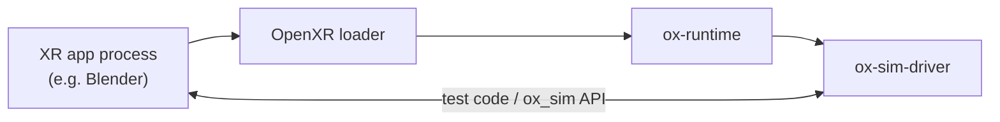
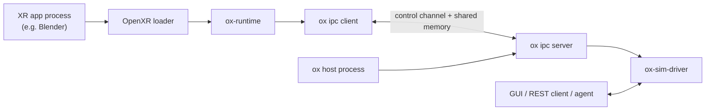

# Architecture

ox can run in two modes. The mode depends on which driver the runtime loads. It is not a build option.

- **Single-process mode** is for automated testing. The application loads the runtime, and the runtime loads the simulator driver into the same process.
- **Split-process mode** is for the GUI, the REST API, and drivers for real hardware. The application loads the runtime, which loads `ox_ipc_client`. A separate `ox` host process loads `ox_ipc_server`, and the server loads the real driver.

## Single-process mode

```
XR application process (for example Blender)
    -> OpenXR loader
        -> ox-runtime
            -> ox-sim-driver
```

The application sets `XR_RUNTIME_JSON` to the ox manifest and `OX_USE_SIMULATOR=1`. The runtime then loads `drivers/simulator/ox_driver` from its own folder. Test code in the same process calls the `ox_sim.h` API to move devices and read frames.

There is no socket and no shared memory. This is the best mode for automated tests, because nothing outside the application can add timing differences.



## Split-process mode

```
XR application process                    ox host process
  OpenXR loader                              ox
    ox-runtime                                 ox_ipc_server
      ox_ipc_client  <--- IPC / shared mem --->   ox-sim-driver
                                                       ^
                                                       |
                                              GUI / REST client / agent
```

The runtime in the application loads a driver. That driver is `ox_ipc_client`, which implements the `ox_driver.h` callbacks by reading shared memory and sending small control messages. The `ox` host process loads `ox_ipc_server`, gives it the real driver, and starts the server. The simulator GUI and REST API live in that driver, inside the host.



The split has two benefits. If the driver crashes, the application keeps running. And the GUI or an HTTP client can inspect the driver while the application runs. The cost is extra latency and more things that can fail, so tests avoid it.

## How a driver is chosen

`ox-runtime` picks a driver when the loader first loads the runtime, unless one is already installed. The order is:

1. **A test driver installed by the test code.** The runtime tests export `ox_set_driver()` and install a mock driver before any OpenXR call.
2. **`OX_RUNTIME_DRIVER`.** A path to a driver library. The runtime turns it into an absolute path and loads it. This is the debug path for a custom driver.
3. **`OX_USE_SIMULATOR=1`.** The runtime loads `drivers/simulator/ox_driver` from the runtime library's folder.
4. **`ox_ipc_client`.** The default. The runtime loads the IPC client from its own folder and expects an `ox` host to be running the real driver.

The code is in `LoadConfiguredDriver()` in [`runtime.cpp`](https://github.com/ox-runtime/ox-runtime/blob/main/src/runtime.cpp). The host has its own rule: it expects exactly one driver folder under `drivers/`, loads `ox_driver` from it, and gives it to `ox_ipc_server`.

## How frames move

The application calls `xrEndFrame` with projection layers. The runtime copies the eye images from the graphics API into CPU memory, fixes the row order, and calls the driver's `submit_frame_pixels`.

- In single-process mode, the simulator driver stores the pixels for the GUI and the C API.
- In split-process mode, `ox_ipc_client` writes the pixels into shared memory. The IPC server's frame loop polls the real driver at about 90 Hz and forwards the image to it, which updates the GUI and REST preview.

The runtime asks the driver for eye poses through `update_view` when the application calls `xrLocateViews`. In split mode, the IPC client reads the latest pose from shared memory instead. The server calls the real driver.

## How input moves

The application syncs actions and reads action state. The runtime maps each binding to a user path and a component path, then calls the driver's `get_input_state_bool`, `get_input_state_float`, or `get_input_state_vector2f`.

- The simulator driver reads its own simulator state. The C API, GUI, and REST API all change that same state.
- In split mode, the client reads input slots from shared memory. The server registers those slots and refreshes them from the real driver on every frame-loop iteration. Session state changes travel over the control channel.

## Host settings

The `ox` host reads `config.yaml` from its own folder. Driver settings are grouped under `drivers/<driver-folder-name>/`. The host flattens nested keys into dotted names and passes them to the driver's `set_config_bool`, `set_config_int`, `set_config_float`, or `set_config_string` callback. The shipped file enables the simulator GUI and REST API:

```yaml
drivers:
  simulator:
    gui:
      enabled: true
    rest_api:
      enabled: true
      port: 8765
```

## Where to go next

- [Runtime](runtime.md) for the OpenXR implementation and the graphics backends.
- [Simulator](simulator.md) for device profiles and the control API.
- [IPC proxy](ipc.md) for the control channel and shared memory.
- [Drivers](drivers.md) for the driver contract.
- [Building](building.md) for how the top-level build puts the pieces together.
